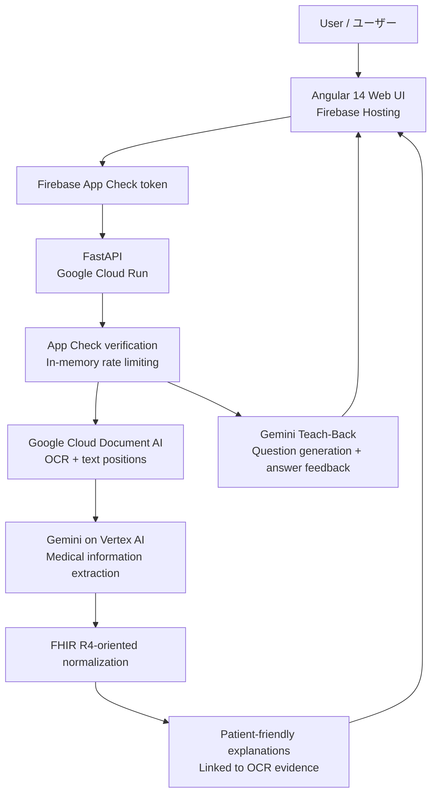

# ClinPlain — Medical documents, explained clearly

**DevFest GDGoC Japan Hackathon 2026 · Team Meidai No.1 · AfterCare Companion**

[**🌐 Live demo / デモを開く**](https://clinplain-devfest-2026.web.app/)

> **Prototype / プロトタイプ:** ClinPlain is an educational hackathon demo, **not a medical device**. It does not provide medical diagnoses or replace advice from healthcare professionals. **Use synthetic or otherwise non-sensitive test documents only.** Uploaded content is processed by cloud AI services; do not upload real patient information to this public demo.

**Languages / 対応言語:** Interface: **English / 日本語** · AI explanations and Teach-Back: **English / 日本語 / Tiếng Việt**

---

## 🇯🇵 日本語

### プロジェクト概要

退院後の説明書、診療メモ、検査結果などの医療文書には、専門用語や複雑な指示が含まれることがあります。患者さんや家族が内容を理解し、医療者に確認したい点を整理することは、必ずしも簡単ではありません。

**ClinPlain** は、医療文書の画像を読み取り、専門的な内容をわかりやすく説明し、**その説明の根拠となる原文を確認できる** Web アプリケーションです。さらに、**Teach-Back（理解度チェック）** を通じて、利用者が自分の言葉で説明を振り返ることを支援します。

### 主な機能

1. **文書アップロード・OCR** — PNG/JPG 画像を最大 12 枚までアップロードし、Google Cloud Document AI で文字情報と位置情報を抽出します。
2. **医療情報の抽出・説明** — Gemini が医療上の重要情報を整理し、選択した言語でわかりやすい説明を生成します。
3. **根拠の可視化（Source-linked Evidence）** — 医療情報を選択すると、対応する原文と OCR の位置（bounding box）を文書ビューアで確認できます。
4. **構造化（FHIR R4）** — 抽出情報を FHIR R4 に沿った形式へ整理する処理を備えています。マッピング結果には確認を要する場合があります。
5. **Teach-Back** — 文書に関する質問を生成し、回答を評価して、不足している理解を振り返るためのフィードバックを返します。
6. **多言語対応** — 画面表示は英語／日本語、AI の説明と理解度チェックは英語／日本語／ベトナム語に対応します。**画面言語と AI の出力言語は独立して選択できます。**

### 使い方（ライブデモ）

1. [ClinPlain](https://clinplain-devfest-2026.web.app/) を開き、画面右上で **EN / 日本語** を選択します。
2. **個人情報を含まない合成テスト用の医療文書画像** を選択します。
3. AI の**説明言語**（English / Japanese / Vietnamese）を選択し、**Analyze Documents / 文書を解析** を実行します。
4. 要約と医療情報を確認します。項目をクリックして、**原文の根拠とハイライト** を表示します。
5. **Teach-Back / 理解度チェック** で質問を生成し、自分の言葉で回答してフィードバックを確認します。

**入力制限（現在の実装）:** PNG/JPG のみ。最大 12 枚、1 枚あたり 5 MB、合計 25 MB。**PDF の直接アップロードには未対応**です。無料デモではレート制限に達すると `429 Too Many Requests` が返る場合があります。その際は `Retry-After` に従ってから再試行してください。

### システム構成



### 使用技術

| レイヤー | 技術 | 用途 |
|---|---|---|
| Frontend | Angular 14, TypeScript, SCSS | 文書アップロード、解析結果、根拠表示、Teach-Back、UI 多言語化 |
| Frontend hosting | Firebase Hosting | 公開 Web アプリの配信 |
| Application protection | Firebase App Check, Firebase Admin SDK | API リクエストの App Check トークン検証 |
| Backend | Python 3.11, FastAPI | OCR／AI 解析と Teach-Back の REST API |
| Container hosting | Google Cloud Run | バックエンドの実行 |
| OCR | Google Cloud Document AI | 文書からテキストと位置情報を取得 |
| Generative AI | Gemini via Vertex AI | 医療情報抽出、説明生成、Teach-Back |
| Data representation | FHIR R4-oriented JSON | 医療情報の構造化 |

### 設計上の特徴

- **説明と根拠の対応付け:** AI が生成した説明だけではなく、元の文書の該当箇所を確認できます。
- **理解度を重視:** 「読む」だけでなく、質問に回答することで内容の理解を振り返れます。
- **言語の独立性:** 日本語 UI を使いながら、英語やベトナム語で AI の説明を受けることもできます。
- **バックエンドによる検証:** 公開 Cloud Run サービスの API では Firebase App Check トークンを検証し、リクエスト頻度を制限しています。ただし、App Check は本人認証ではありません。

### 制限事項・安全上の注意

- **研究・教育目的のデモ**であり、診断、治療方針の決定、服薬指示の代替には使用できません。
- OCR や生成 AI の出力には誤りが含まれる可能性があります。重要な情報は必ず原文と医療専門家に確認してください。
- この公開デモには**実在する患者の氏名、診療記録、個人情報などをアップロードしないでください**。入力はクラウド側で処理されます。
- レート制限は現在、インスタンス内メモリを使用するデモ向け実装です。永続的・ユーザー別の厳密な制御や、費用の絶対上限を保証するものではありません。
- FHIR への変換は臨床システムとの完全な相互運用性や認証を意味するものではありません。

---

## 🇬🇧 English

### The problem

Discharge notes, clinical records, and laboratory reports can be difficult to understand without medical training. Patients may struggle to identify the most important instructions, verify where an explanation came from, or formulate useful follow-up questions.

### Our solution

**ClinPlain** is a web-based **AfterCare Companion** that turns images of medical documents into easier-to-read explanations **linked to the original document evidence**. Its Teach-Back interaction helps users check their understanding by answering short questions in their own words.

### Key features

- **OCR of medical-document images:** Extract text and source positions using Google Cloud Document AI.
- **Plain-language AI explanations:** Use Gemini to organize relevant medical facts and explain them in the chosen output language.
- **Traceable source evidence:** Select a medical fact to inspect the associated OCR quote and bounding-box highlight in the original image.
- **FHIR R4-oriented structuring:** Normalize extracted information into a structured representation, with mappings that may require review.
- **Teach-Back:** Generate comprehension questions, evaluate user answers, and provide actionable feedback, including when answers are incomplete.
- **Independent language settings:** English/Japanese interface; English/Japanese/Vietnamese AI-generated content.

### Try the live demo

Open **https://clinplain-devfest-2026.web.app/** and:

1. Select **EN** or **日本語** for the interface.
2. Upload **synthetic, non-sensitive** medical-document images (PNG/JPG).
3. Choose the **AI explanation language** independently of the interface language.
4. Run **Analyze Documents** and inspect the explanation and its linked OCR highlights.
5. Open **Teach-Back**, generate questions, and submit an answer to see feedback.

**Current upload limits:** Up to 12 images, 5 MB per image, 25 MB total. **Direct PDF uploads are not yet supported.** Because this is a controlled public demo, requests may be rate-limited (`HTTP 429`); use the `Retry-After` response before retrying.

### Architecture and tools

The diagram and technology table in the Japanese section above describe the full system. In brief: **Angular on Firebase Hosting → FastAPI on Cloud Run → Document AI + Gemini on Vertex AI**, with **Firebase App Check validation** and **in-memory request rate limiting** on the API.

### Safety and scope

ClinPlain is **not** a medical device or a source of clinical advice. Outputs can be incorrect or incomplete; source evidence and professional review remain important. **Do not upload real patient or other sensitive personal information** to the public demo. Cloud AI services process uploaded documents. FHIR-oriented output is not a claim of clinical interoperability certification, and the current application-level limits are not a guaranteed spending cap.

---

## Local development / ローカルでの起動

The repository contains a Python/FastAPI backend and an Angular frontend under `webclient/`. Production credentials and cloud configuration are **not** committed to this public repository.

**Backend / バックエンド** (Python 3.11 recommended):

```bash
python -m pip install -r requirements.txt
python -m uvicorn main:app --reload --host 127.0.0.1 --port 8000
```

**Frontend / フロントエンド** (run in another terminal):

```bash
cd webclient
npm install
npx ng serve
```

Open `http://localhost:4200/`. The development frontend is configured to call the local API at `http://localhost:8000`; production builds target the deployed Cloud Run backend.

> **Cloud setup required / クラウド設定が必要です:** To execute actual OCR/AI analysis locally, configure Google Cloud credentials and the application's Document AI / Vertex AI settings according to the backend source and your own cloud project. Service-account keys, tokens, `.env` files, and other secrets must not be committed. The public deployment uses an attached Cloud Run service account. The commands above start the application, but do not provision Google Cloud resources.

### API overview / 主な API

| Endpoint | Purpose |
|---|---|
| `GET /health` | Service health check |
| `POST /api/documents/analyze` | Upload images and run the full analysis pipeline |
| `POST /api/teachback/generate` | Generate Teach-Back questions |
| `POST /api/teachback/evaluate` | Evaluate a Teach-Back answer |

Other analysis endpoints are exposed by the backend; see the FastAPI route definitions. Production `/api/*` requests require a valid Firebase App Check token, so directly invoking the public Cloud Run URL with a bare `curl` command will normally return `401`.

---

## Submission, security and license / 提出・セキュリティ・ライセンス

- **This is the public final-submission repository for DevFest Hackathon 2026.** The organizers and judges evaluate the code and materials **in this repository**, not only in an external development repository. Submit everything required before the organizer's deadline.
- **GitHub Actions and GitHub Pages are unavailable** in this submission repository; hosting is provided separately through Firebase Hosting and Cloud Run.
- **Never commit secrets**, API keys, service-account keys, passwords, `.env`, or sensitive test data. If credentials are exposed, revoke/rotate them immediately; deleting the file alone is not sufficient.
- The organizer's original repository instructions are preserved in [`SUBMISSION_NOTES.md`](SUBMISSION_NOTES.md).
- **License:** [MIT](LICENSE), consistent with the repository's existing license notice.

---

**Team:** Meidai No.1 · **Project:** ClinPlain · **Event:** DevFest GDGoC Japan Hackathon 2026
